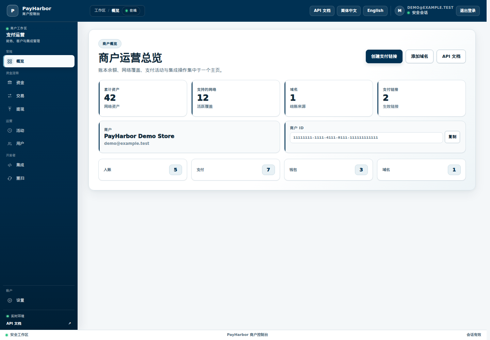
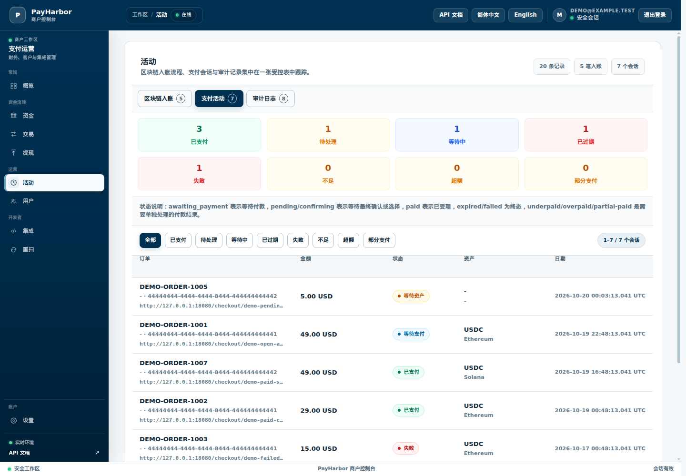
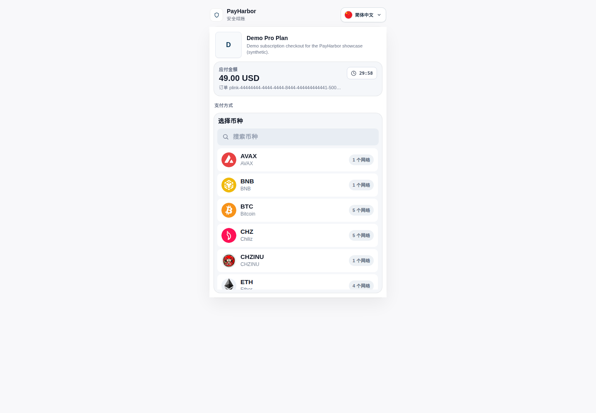

# PayHarbor

PayHarbor 是一个用 Go 编写的多链加密货币支付网关与钱包基础设施。商户可以用它收单，开发者可以生成用户级多链地址，钱包/交易所类产品可以在同一套资金核心上完成入账、支付、出账、退款、归集、Webhook 投递与对账。

语言：[**简体中文**](README.md) | [English](README.en.md)

> **当前状态**：本地可验证的工程项目，尚未部署到生产，也未做安全审计或认证。边界见[已知边界](#已知边界)。

## 它解决什么问题

| 问题 | PayHarbor 的做法 | 结果 |
| --- | --- | --- |
| 商户想收加密货币，但不想为每条链各搭一套收银台、钱包、监听器与 Webhook。 | 托管收银台、支付会话、静态充值地址、商户 API 与多链资产注册表整合在同一产品中。 | 接入更快，出错面更小。 |
| 手工生成与跟踪用户级充值地址容易出错。 | 基于 Trust Wallet Core 的 HD 钱包/地址生成、地址查询、链监听器与充值生命周期服务协同工作。 | 用户与地址的匹配、支付跟踪系统化。 |
| 团队难以回答链上款项是否到账、确认了多少、是否少付或多付。 | 支付会话、预期金额、链/资产匹配、终局性 worker 与支付状态事件共同给出答案。 | 商户、管理员与 Webhook 消费方都能看到支付状态。 |
| 网络重试可能对同一订单重复创建支付。 | `Idempotency-Key` 与请求载荷指纹配合去重。 | 客户端重试更安全，重复发票风险降低。 |
| Webhook 回调失败时商户系统可能漏掉资金事件。 | 持久化投递记录、HMAC 签名、重试、重放与诊断界面。 | 回调可检查、可重放。 |
| 只把交易行当作余额来源时，账很难对平。 | 账本派生余额、储备对账任务与资金事件 outbox 提供明确的记账路径。 | 余额权威明确，漂移与恢复工作可见。 |
| 出账、退款与归集涉及私钥、费用、nonce/UTXO 与审批风险。 | 签名器模式守卫、链资源策略、归集任务、退款/出账生命周期状态与就绪门禁分离风险边界。 | 受控 Beta 的限额清晰，生产托管声明仍以证据为准。 |
| “生产就绪支付网关”的说法往往含糊。 | 受控发布就绪等级、`/api/v1/common/readiness`、`/metrics`、runbook 与审计文档界定当前成熟度。 | Beta、生产网关、钱包托管与交易所级跟踪之间的界线保持明确。 |

## 适用场景

- **商户/经销商团队**：需要收加密货币、签发收银链接、生成静态充值地址，并通过 Webhook 更新自有系统。
- **开发者集成方**：需要带 API Key、HMAC 签名、幂等、托管收银台、静态钱包与 Webhook 契约的加密支付 API。
- **钱包/交易所类产品团队**：需要用户级多链充值钱包、账本、对账、出账、退款、归集与 provider 健康检查统一在一套资金核心中。
- **运维与安全团队**：需要观察资金流转、Webhook 积压、签名器就绪、provider 延迟、迁移状态、对账漂移与管理恢复。

## 核心功能

- **收单与商户 API**：托管收银台、发票/支付链接、静态充值地址、`/api/v1` 商户 API。
- **多链钱包基础设施**：基于 Trust Wallet Core 的 BIP39/HD 地址派生与地址校验。
- **链上事实与入账**：链监听器把链上交易整理为持久化事实，经过确认策略与支付匹配后进入账本。
- **双分录账本**：充值、支付、提现、退款、归集以借贷分录记录，余额按商户/域/链/资产隔离。
- **出账与安全栅栏**：提现/退款/归集通过单事务发送授权（资源行锁 + CAS + 已持久化尝试栅栏）取得广播权；广播结果不确定时升级为人工任务，不自动重发。
- **退款**：退款创建在单个事务内锁定支付单、按同一支付单的有效退款总额（含已成功退款）封顶，并原子写入退款、hold 与生命周期事件。
- **Webhook 与事件投递**：商户 API 使用签名与时间窗；Webhook 由平台签名投递，事件携带事件 ID/幂等键供消费方去重；失败投递有记录与重试。
- **对账与运维**：资金不变量检查、储备余额检查、卡住生命周期案件、归集运维台账与操作员后台。
- **商户/管理后台**：服务端渲染的商户门户与管理门户，支持中英文界面。

## 界面预览

以下截图为本地隔离环境中的中文演示界面。商户、订单与金额均为合成数据，不代表真实交易或生产部署。



<details>
<summary>查看支付活动与托管收银台截图</summary>





</details>

## 支持网络与资产

支持网络：

- Bitcoin
- Ethereum
- TRON 与 TRON Nile 测试网
- Solana
- Avalanche C-Chain
- BNB Chain
- Chiliz 与 Chiliz Spicy 测试网
- Base
- Arbitrum One
- Unichain

已注册资产示例：

- 原生资产：BTC、ETH、TRX、SOL、AVAX、BNB、CHZ
- 稳定币与包装代币：USDT、USDC、WBTC、WETH、WBNB、WAVAX、WCHZ、WSOL
- ERC-20、SPL 与 TRC-20 代币记录
- 包装代币别名：WBTC → BTC、WETH → ETH、WBNB → BNB、WAVAX → AVAX、WCHZ → CHZ、WSOL → SOL

链记录在 `application/configuration/chains.go`，资产记录在 `application/configuration/assets.go`。

## 支付流程

1. 商户通过商户门户、管理门户或内部端点创建商户账号。
2. 配置商户域：API key、API secret、Webhook URL、Webhook secret 与权限 scope。
3. 商户通过 `/api/v1/payment/create`、托管收银台或门户创建发票/支付会话。
4. 客户在收银台选择受支持的链与资产。
5. PayHarbor 展示充值地址与二维码，并持续跟踪链上交易与确认数。
6. 确认与支付匹配完成后，资金事实进入双分录账本，并向商户投递签名 Webhook。

## 项目状态与安全边界

- 本项目是**本地可验证工程**：未部署到生产，未做安全审计或认证；本文档不声明生产可用性。
- 生产托管必须使用外部签名器适配器，进程内软件签名仅用于开发环境。
- 商户 API 请求使用 API Key/Secret 签名，并校验时间窗；商户密钥以 AES-GCM 加密存储（由 `MASTER_KEY` 派生）。
- Webhook 由平台签名投递，消费方应校验签名，并用事件 ID/幂等键做投递去重；平台侧不声称替代消费方的全部重放防护。
- 出站策略包含地址白名单、限额与链级维护开关；未满足条件时不广播。
- 幂等分层：API 请求以幂等键去重，资源与账务写入以唯一键去重，二者不依赖同一条事务记录；退款行、hold 与生命周期事件在同一事务提交，出账广播权由独立事务授权并以持久化尝试栅栏约束。
- worker lease 只用于减少多实例重复认领，不是互斥保证。
- 广播结果不确定、归集/出账 hold 与只读观察组件的具体限制见[已知边界](#已知边界)。

## 开发文档

- [开发者指南](docs/developer-guide.md)：本地开发循环、迁移、worker、测试与 PR 约定。
- [离线开发环境](docs/offline-development.md)：`GATEWAY_OFFLINE=true`，无监听器、无资金 worker、无出站流量。
- [基线测试栈](deploy/compose/baseline/README.md)：Prepare/Build/Test/Smoke 四阶段，内部网络不发布宿主端口。
- [资金链路可观测性手册](docs/money-path-observability-runbook.md) 与 [归集运维手册](docs/sweep-operations-runbook.md)。
- [集成指南](docs/integration-guide.md)：签名、端点、状态、Webhook 与错误处理契约。
- [项目笔记](docs/portfolio.md)：架构与验证说明。

## 项目结构

```text
api/          HTTP 路由、处理器与中间件
services/     业务服务（资金、Webhook、实时推送、对账、观察等）
repositories/ 数据库访问与事务边界
models/       GORM 模型
blockchain/   链接口与各链实现
workers/      链监听器与事件分发器
asset/        资产注册表
application/  装配与链/资产配置入口
views/        服务端渲染模板（收银台、商户与后台）
```

`main.go` 负责装配、迁移/种子、worker 监督者与各周期任务；`api/routes/routes.go` 把路由装配到 Fiber 应用。

## 要求

- Go `1.25.4`
- PostgreSQL 16
- Node.js 与 npm（Tailwind CSS 输出）
- Git 子模块支持
- CGo 与 clang/cmake 等 Trust Wallet Core 原生构建工具

主要技术栈：

- Go `1.25.4`
- Go Fiber v3（HTTP）、GORM（ORM）
- PostgreSQL 16
- Trust Wallet Core（原生库，CGo）
- Tailwind CSS 与服务端 HTML 模板

## 安装

克隆仓库（包含子模块）：

```bash
git clone --recurse-submodules https://github.com/xtianxx/PayHarbor.git PayHarbor
cd PayHarbor
```

原生库首次构建耗时较长，请预留时间：

```bash
./scripts/build_wallet_core.sh
```

准备配置（参考 `.env.sample`；至少需要 `DATABASE_URL`、`MASTER_KEY`、`PORT`、`MNEMONIC_PHRASE`）：

```bash
cp .env.sample .env
```

先编辑 `.env`，填入本地开发配置；不要使用生产凭据或存放真实资金的助记词。首次启动：

```bash
go run . -install
```

`-install` 执行迁移与种子步骤后会继续启动 HTTP 服务，不会自动退出。后续启动可使用 `go run .`（默认监听 `:3001`）。

本地隔离验证环境见[离线开发环境](docs/offline-development.md)（`GATEWAY_OFFLINE=true`，无监听器、无资金 worker、无出站流量，通过回环 relay 发布端口）；容器化基线测试与门禁见[基线测试栈](deploy/compose/baseline/README.md)（内部网络、不发布宿主端口）。

## 测试与开发

```bash
go test ./...                          # Go 测试套件（部分方案需要 PostgreSQL 测试库）
go test ./services/outboundobserver/   # 只读链上观察组件回归
```

- 容器化基线运行器以真实退出码与 JSON 事件流作为门禁：`scripts/baseline/run-tests.sh` + `scripts/baseline/verify-test-json.py`。
- 本仓库未声明 CI 已通过；CI 状态以实际运行结果为准。
- 本地开发循环、迁移与 worker 约定见[开发者指南](docs/developer-guide.md)。

## 已知边界

- 本项目是**本地可验证工程**：未部署到生产，未做安全审计或认证；本文档不声明生产可用性。
- 已广播但结果不确定的出账**不会自动重发**，也不会自动释放 hold；这类案件进入操作员处理。
- 归集/出账在广播后保留资金 hold，需要**人工对账**；BTC/SOL/TRON 的自动出账终态尚未实现。
- `services/outboundobserver` 是**只读**组件：不写数据库、不签名、不广播，且**未接入运行中的 worker**。它报告的确认深度只是观察值，不代表 PoS/L2 最终性。
- 仓库根目录暂无 `LICENSE` 文件；第三方组件（如 `third_party/trustwallet/` 的 Trust Wallet Core）保留各自上游许可，本项目未新增或变更许可证。

## 第三方许可

`third_party/` 下的组件（包括 Trust Wallet Core 子模块）遵循其各自上游许可证；发布或分发前请按上游要求保留相应声明。
